<!-- ============================================ -->
<!-- HEADER -->
<!-- ============================================ -->

  <!-- PINK HEADER: DARK / LIGHT -->

  <picture>
    <source
      media="(prefers-color-scheme: dark)"
      srcset="https://capsule-render.vercel.app/api?type=waving&amp;color=0:45112E,50:AD3277,100:F472B6&amp;height=230&amp;section=header&amp;text=Anna%20Kuts&amp;fontColor=FFFFFF&amp;fontSize=56&amp;fontAlignY=34&amp;animation=fadeIn&amp;desc=Building%20products%20from%20zero%20to%20one&amp;descSize=22&amp;descAlignY=58">
    <source
      media="(prefers-color-scheme: light)"
      srcset="https://capsule-render.vercel.app/api?type=waving&amp;color=0:FDE7F4,50:FBC2EB,100:F472B6&amp;height=230&amp;section=header&amp;text=Anna%20Kuts&amp;fontColor=831843&amp;fontSize=56&amp;fontAlignY=34&amp;animation=fadeIn&amp;desc=Building%20products%20from%20zero%20to%20one&amp;descSize=22&amp;descAlignY=58">
    
  </picture>

<!-- ============================================ -->
<!-- MEET SYMON -->
<!-- ============================================ -->

  <h2>Product Manager | Software Engineering student at KPI</h2>
  
<i>Meet my cat Symon — my personal code supervisor 🐈</i>

  <!-- ANIMATED GINGER CAT -->

  <picture>
    <source
      media="(prefers-color-scheme: dark)"
      srcset="https://raw.githubusercontent.com/AnnKuts/AnnKuts/main/dist/pet.svg">
    <source
      media="(prefers-color-scheme: light)"
      srcset="https://raw.githubusercontent.com/AnnKuts/AnnKuts/main/dist/pet-light.svg">
    
  </picture>

---

<!-- ============================================ -->
<!-- CONTACT -->
<!-- ============================================ -->

<h2>Contact me at</h2>

  

    
    
  

<!-- ============================================ -->
<!-- TOOLS -->
<!-- ============================================ -->

<h2 align="center">Tools</h2>

---

<!-- ============================================ -->
<!-- GITHUB STATISTICS -->
<!-- ============================================ -->

<h2>my GitHub in numbers</h2>

  <!-- TOP LANGUAGES BY COMMIT -->

  <picture>
    <source
      media="(prefers-color-scheme: dark)"
      srcset="https://github-profile-summary-cards.vercel.app/api/cards/most-commit-language?username=AnnKuts&amp;theme=github_dark">
    <source
      media="(prefers-color-scheme: light)"
      srcset="https://github-profile-summary-cards.vercel.app/api/cards/most-commit-language?username=AnnKuts&amp;theme=default">
    
  </picture>

  <!-- GITHUB STATS -->

  <picture>
    <source
      media="(prefers-color-scheme: dark)"
      srcset="https://github-profile-summary-cards.vercel.app/api/cards/stats?username=AnnKuts&amp;theme=github_dark">
    <source
      media="(prefers-color-scheme: light)"
      srcset="https://github-profile-summary-cards.vercel.app/api/cards/stats?username=AnnKuts&amp;theme=default">
    
  </picture>

<!-- ============================================ -->
<!-- SYMON'S CONTRIBUTION CITY -->
<!-- ============================================ -->

<h2>Symon's contribution city</h2>

  <!-- ISOMETRIC CONTRIBUTION CITY -->

  <picture>
    <source
      media="(prefers-color-scheme: dark)"
      srcset="https://raw.githubusercontent.com/AnnKuts/AnnKuts/main/dist/isocat.svg">
    <source
      media="(prefers-color-scheme: light)"
      srcset="https://raw.githubusercontent.com/AnnKuts/AnnKuts/main/dist/isocat-light.svg">
    
  </picture>

---
